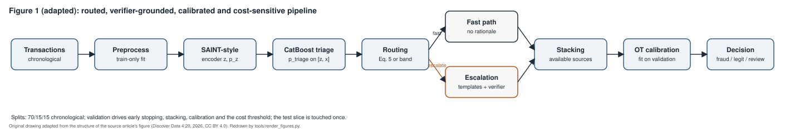

# templar-fraud-lab

Transaction fraud screening has to decide quickly, explain itself when it hesitates, give
probabilities that mean what they say, and respect that a missed fraud costs more than a
false alarm. This repository is an independent implementation of a routed, verifier-grounded,
calibrated and cost-sensitive fraud decision pipeline, runnable end to end on authored
synthetic data, with a written audit of where the source paper is ambiguous and what this
code assumes.

**Status:** `demo_ready` (runs end to end on authored synthetic fixtures; no real-data
evaluation performed in this repository).

## Problem and user

A fraud operations team receives a stream of card transactions with a fraud rate of a few
percent. They need (1) a fast score for the bulk of clearly legitimate traffic, (2) a
structured, checkable rationale when a transaction is escalated, (3) a probability whose
calibration can be inspected, and (4) a decision threshold chosen against an explicit cost
of false positives, false negatives and human review. The user of this code is an analyst or
engineer who wants to see each of those pieces working and testable before trusting any
number from a paper.

## Demo

`python -m templar_fraud_lab demo` runs the whole pipeline on the synthetic fixture and writes
`examples/output/`: predictions, metrics, reliability bins, a template bank, a run manifest,
the late-slice overlap report and `demo_trace.json`, which walks eight sample transactions
stage by stage (three fast-path rows, three escalation rows that passed the verifier, two
that failed and were routed to review). Charts in `docs/figures/chart_*.svg` are drawn from
those actual predictions; no curve is ever synthesised from a summary number.



## Implementation status

Works on the fixture, tested:

- Dataset adapters for BAF Base and IEEE-CIS that validate schema and raise an actionable
  error naming the source when the data is absent (no rows shipped).
- Chronological 70/15/15 split, final-10% late slice with the intersection measured and
  exported, forward-chaining 5-fold splitter.
- Train-only preprocessing (median imputation, missing token, one-hot and frequency
  encoding, RobustScaler) and expanding-window out-of-fold smoothed target encoding.
- Compact SAINT-style encoder in torch with feature-wise and intersample attention under an
  explicit historical-context mask (a row attends only to earlier-or-equal timestamps).
- CatBoost triage on [z, x] with class weight equal to the legit/fraud ratio of the training
  fold; both routing rules from the paper (`eq5`, `band`) behind a config switch.
- Structured rationales over an allowlisted predicate AST with a tiny interpreter (never
  `eval`); a hand-written 16-template demo bank; a small Monte Carlo tree search that appends
  discovered templates and persists the bank as JSON.
- Deterministic verifier (schema, feature support, range, predicate consistency); a failure
  routes to review and never yields a verdict.
- Source-mask-aware Bayesian stacking with a Dirichlet(1) prior and per-row renormalisation
  over available sources; a disagreement proxy.
- One-dimensional optimal-transport calibration by quantile matching, with isotonic
  regression as a comparator; expected calibration error with bin counts.
- Cost-sensitive threshold search on the paper's grid with a deterministic tie-break and a
  three-way fraud / legitimate / review decision.

Deliberately not implemented (see docs/paper-implementation-audit.md): the paper's full
encoder dimensions and search budget, the 64-template MCTS bank over a 50,000-row corpus,
graph features, the FraudGT baseline, and any real-data run.

## Quickstart (offline, CPU, under a minute)

```
pip install -e . && pip install pytest      # or: make setup
python -m templar_fraud_lab smoke           # about 15 s of compute; checks outputs and schema
python -m templar_fraud_lab demo            # about 80 s of compute; writes examples/output/
python -m templar_fraud_lab audit           # prints the ambiguity audit with measured values
python -m pytest -q
```

Other commands: `train` (encoder and triage checkpoints only), `evaluate` (re-score a saved
predictions file; exit 2 when inputs are missing), `figures`, `make-fixture`.

## Data

See [DATA_CARD.md](DATA_CARD.md). The only data in this repository is the authored synthetic
fixture `examples/fixtures/v1/` (6,000 fictional transactions, seed 42, about 2% fraud, with a
late-appearing merchant category and a few very large amounts so unknown-category and
out-of-range handling are exercised on the test slice). BAF Base is a synthetic bank
account-opening benchmark from Feedzai (NeurIPS 2022 Datasets and Benchmarks), not observed
payments; IEEE-CIS is the Kaggle competition data. Both must be obtained by the user and
pointed to with `--data-root`.

## Architecture / method

Ingest, preprocess, encode, triage, route, escalate (templates then verifier), stack,
calibrate, decide. Full description with the settings taken from the paper in
[docs/method.md](docs/method.md); the escalation and decision stages are drawn in
`docs/figures/fig2_escalation.svg` and `docs/figures/fig3_stacking_calibration_decision.svg`.

## Train, validate, test

Splits are chronological. Everything that fits is fitted on the training split (the
preprocessor, the target encoder, the encoder, the triage model, the template firings model,
the MCTS reward). Everything that selects is selected on the validation split (encoder early
stopping, stacking weights, the calibration map, the cost threshold). The test split is
touched once. The late slice is the final 10% of rows; on this fixture it is a strict subset
of the test split, which `examples/output/late_slice_overlap.json` records rather than
assumes.

## Results and provenance

Two kinds of numbers exist in this repository and they are never mixed:

- `paper-reported`: values transcribed from the source article into
  `evidence/paper_reported/templar.json` with a table or section locator. They were not
  produced here and are not used as test oracles.
- `demo`: values computed by `make demo` on synthetic fixture v1, seed 42, not a benchmark
  result. They live in `examples/output/metrics.json` and are discussed in
  [docs/evaluation.md](docs/evaluation.md).

Nothing in this repository is `reproduced`; no real-data run has happened here.

## Limitations

- The fixture has 122 fraud rows in total (74 in training). Ranking metrics on it are noisy
  and the tree ensemble overfits easily; the demo shows the mechanics, not the achievable
  accuracy on real data.
- With a prevalence near 2%, calibrated probabilities after quantile matching are compressed
  into a narrow low range, and an equal-width-bin ECE is dominated by the first bin. Read the
  reliability bins, not the single ECE number.
- The encoder is a compact variant with a bottleneck before intersample attention; it is not
  the paper's 6-block, 8-head model.
- The routing rule, the calibration construction and the cost units are ambiguous in the
  paper; this code picks one reading for each and records the choice.

## Relationship to research

This repository is an independent implementation related to the article "TEMPLAR fraud a
verifier grounded calibrated and cost sensitive framework for transaction fraud detection",
Discover Data 4:20 (2026), DOI https://doi.org/10.1007/s44248-026-00117-y. The article cites
https://github.com/raihandinaribn/templar-fraud as its code source; that repository was not
audited or reused here. The code in this repository was written from the article's text and
equations, and every point where the text underdetermines the implementation is listed in
[docs/paper-implementation-audit.md](docs/paper-implementation-audit.md).

## Contribution

Contribution: baseline comparison, evaluation-metric analysis, robustness interpretation, and manuscript refinement.

## License and sources

MIT License, copyright 2026 Md Sultanul Arefin Sourav (see LICENSE and NOTICE.md). Software
citation in CITATION.cff. Dataset terms are documented in DATA_CARD.md and apply separately.
The architecture figures are original drawings adapted from the structure of the article's
Figures 1 to 3 (CC BY 4.0), produced by `tools/render_figures.py`.
